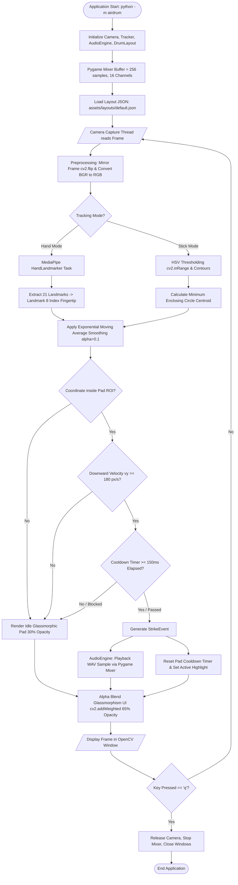
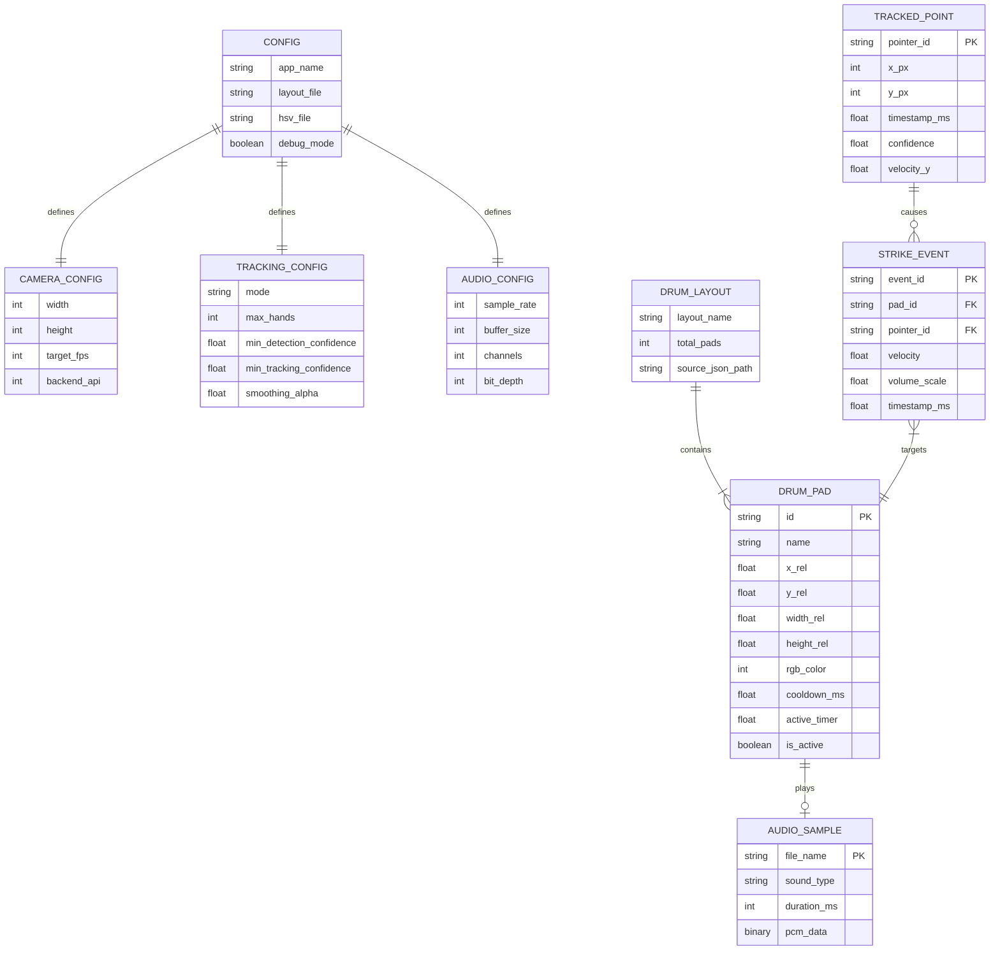
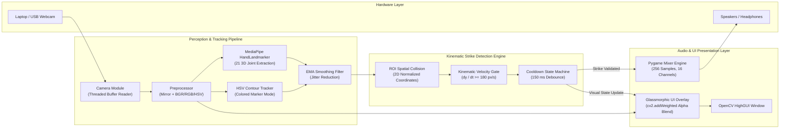
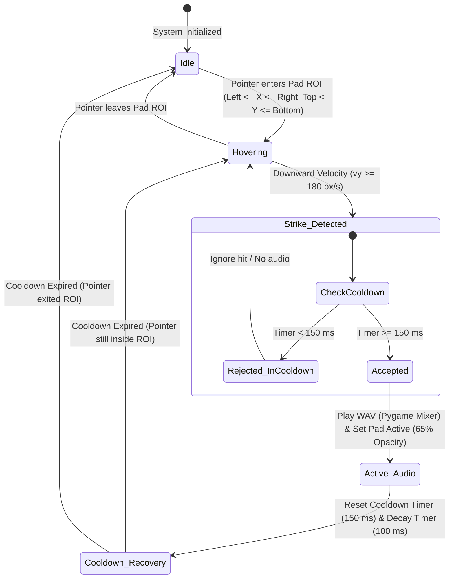
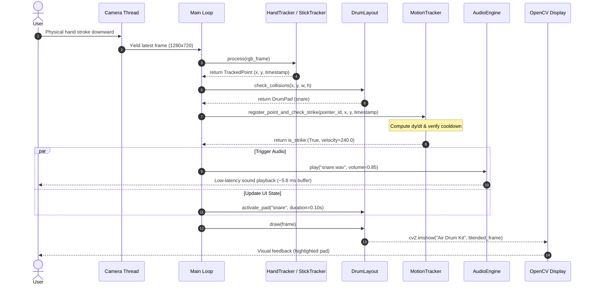
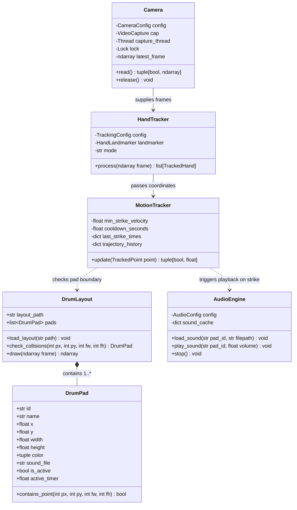

# System Diagrams & Architecture Specifications
**Project:** Computer Vision & AI-Powered Virtual Air Drum Kit  
**Repository:** [air-drum-kit](file:///e:/Code%20Stuffs/AntiGravity%20Projects/Airdrum/air-drum-kit)  
**Date:** October 2026  

---

## 1. System Pipeline Flowchart (Main Runtime Loop)
This flowchart models the end-to-end execution path from hardware webcam frame polling to audio output and visual glassmorphism rendering.

---

## 2. Entity-Relationship (ER) / Data Model Diagram
Although this application uses an in-memory runtime object architecture and JSON persistence rather than a relational database, the data entities, attributes, and relationships map as follows:

---

## 3. High-Level Modular System Architecture Diagram
Illustrates the separation of concerns across physical capture, machine perception, kinematic state analysis, audio synthesis, and visual rendering.

---

## 4. Strike Detector State Machine Diagram
Depicts the state transitions for each virtual drum pad to ensure false strikes (resting hands or micro-rebound oscillations) are rejected.

---

## 5. Sequence Diagram: Frame Processing & Hit Handling
Chronological interaction across software classes during a live drumming strike.

---

## 6. Component Class Diagram (UML)
Shows the object-oriented structure and module dependencies.

